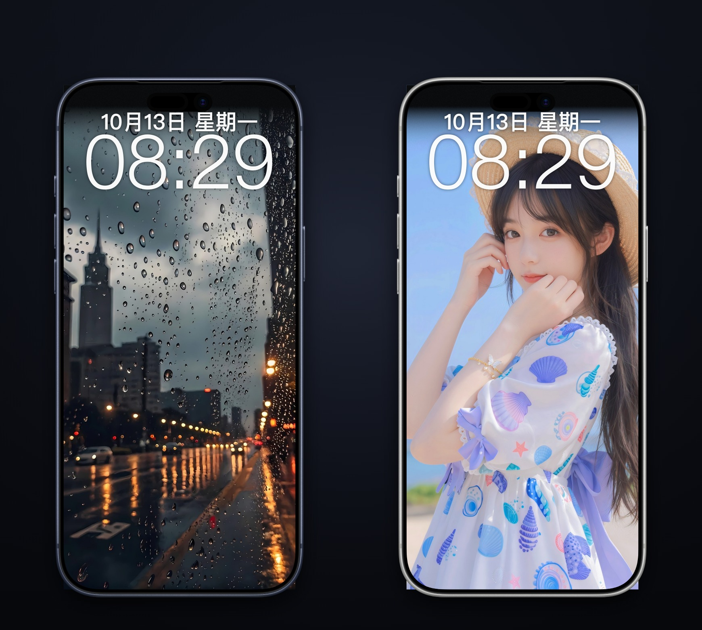
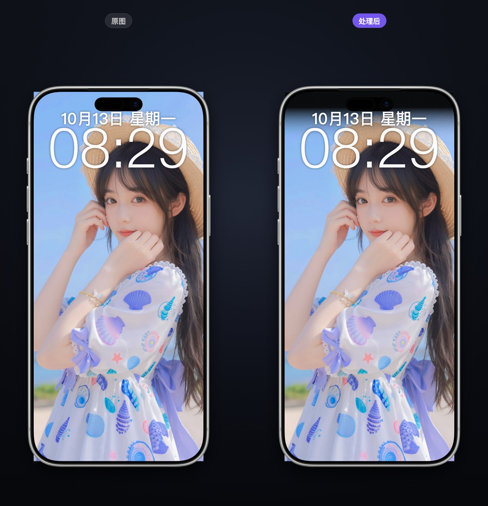
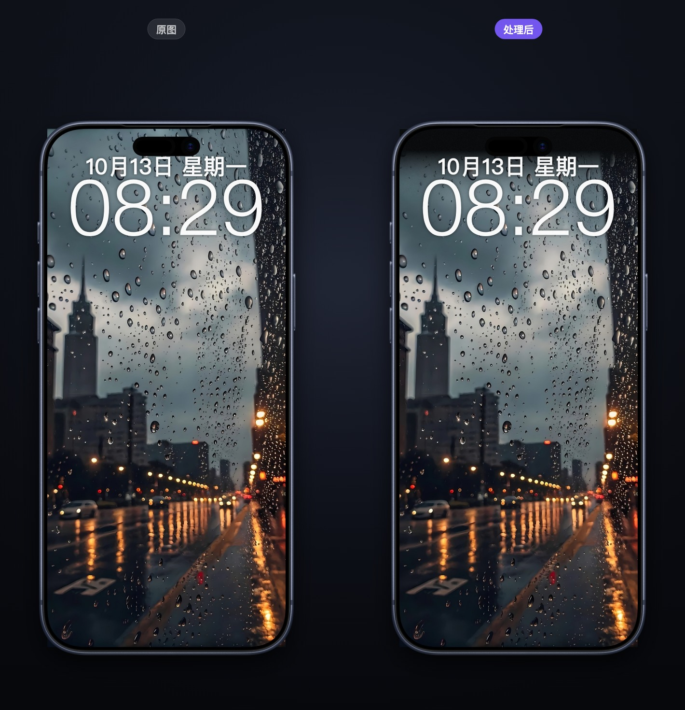
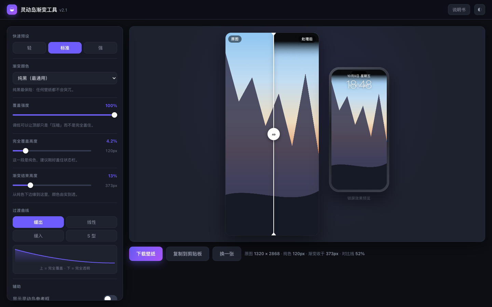

<div align="center">

# Dynamic Island Gradient

**岛影 (Dǎo Yǐng)** — *"island shadow"*, a pun on 倒影 (reflection)

Adds a smooth fade-out mask to the top of any wallpaper so the iPhone's
Dynamic Island and status bar blend into the picture instead of slicing it.

[](LICENSE)
[]()
[]()
[]()
[]()

[简体中文](README.md) · English



</div>

---

## The problem

Since the iPhone 14 Pro, there's a permanent black pill at the top of the
screen. Put a bright photo behind it and the hardware visibly **cuts the
image in half**. Apple's own wallpapers get a darkened top; your own photos
don't.

This tool does exactly one thing: it lays a solid-to-transparent gradient over
the top of the wallpaper.

```
┌──────────────┐         ┌──────────────┐
│  sky          │         │██████████████│  ← solid: covers the island
│              │         │██████████████│
│              │   ──►   │▓▓▓▓▓▓▓▓▓▓▓▓▓▓│  ← fade zone
│   mountains   │         │   mountains   │  ← original, untouched
└──────────────┘         └──────────────┘
```

Two **device-accurate** comparisons — left is the original, where the black
Dynamic Island visibly slices the picture; right is after the mask, where it
blends in and even the lock-screen clock reads better.





> Device bezels are from Apple Design Resources (iPhone 17 Pro Max), used solely
> to depict a mock-up. That image is © Apple Inc. and is **not** covered by this
> project's MIT licence.

Drag the split handle to compare before / after:



The manual is embedded too — one click slides it in, no network, no extra file:


---

## Usage

**No install. No build. No network. One file, works on Windows, macOS and Linux.**

> **HEIC photos from an iPhone just work — no JPG conversion needed.**
>
> HEIC holds HEVC, which is patent-encumbered, so Chrome / Edge / Firefox **deliberately ship no**
> decoder (they bet on royalty-free AVIF instead). Only Safari can read it, via the OS.
> Daoying's audience shoots HEIC by default, so hitting a wall on the very first drag is a dead end.
>
> Hence two builds with identical features, differing only in HEIC:
>
> | | Size | HEIC |
> |---|---|---|
> | **Full build** (recommended — what you get from Releases) | ~2 MB | Bundles an open-source decoder (libheif); **works in every browser** |
> | **Source build** (`index.html` in this repo) | ~74 KB | Relies on the browser; only Safari can decode it |
>
> The bundled decoder only spins up when you actually drop a HEIC in. Every other format still goes
> through the browser's native decoder, so nothing gets slower. (Safari is instant for HEIC too;
> Chrome / Edge / Firefox took ~2.7 s for a 6000×6000 image on the test machine.)
>
> That bundled part is **LGPL-3.0** (libheif / libde265) and is the only non-MIT code in the full
> build. Both licence texts are inlined inside the file, so forwarding that single file still carries
> its licences. `index.html` itself stays a clean **MIT-only** source file.
> See [`tools/README.md`](tools/README.md) for how the build works.

### Just want to use it

Grab a build from the **[Releases page](https://github.com/js-ping/dynamic-island-gradient/releases/latest)**:

| Download | What it is |
|---|---|
| `Daoying-v2.2.1-full-heic.html` | **Recommended** — ~2 MB, bundles the HEIC decoder, **works in every browser** |
| `Daoying-v2.2.1-single-file.html` | ~74 KB, MIT-only source build; HEIC needs Safari |
| `Daoying-v2.2.1-Windows-macOS-Linux.zip` | Full build + both launchers + manual + third-party notice |

> Rename either file however you like — it makes no difference.
> Both are "double-click and go, no network, photos never leave your machine", copyable to a USB stick.

Or clone the repo and use `index.html` (source build, no decoder):

```bash
git clone https://github.com/js-ping/dynamic-island-gradient.git
```

### Opening it

| OS | How to open | Notes |
|---|---|---|
| **Windows** | Double-click `index.html` | If Notepad opens instead, right-click → *Open with* → your browser; or double-click `启动.bat` |
| **macOS** | Double-click `index.html` | Opens in your default browser. Use `启动.command` to serve over LAN for a phone |
| **Linux** | Double-click `index.html` | Or `xdg-open index.html` |

Then:

1. Drop your wallpaper in (or click to pick, or paste with `Ctrl+V` / `⌘V`)
2. Drag the white split line to compare before / after
3. Hit "Download", AirDrop it to your iPhone, set as wallpaper

> The manual is embedded — click "说明书" in the header. This one file can be copied
> to a USB stick, sent over chat, or dropped on any computer and used by double-clicking.
> **It needs no companion files.**

### Browser support

Chrome / Edge / Safari / Firefox and anything else modern — desktop or mobile.

> **HEIC** photos: the **full build** bundles a decoder and works in every browser;
> the **source build** needs Safari. Either way the tool tells you explicitly when it
> can't decode something rather than failing silently.

---

## Features

| Feature | Detail |
|---|---|
| **Three colour modes** | Solid black / sampled from the top of the image / custom colour |
| **Coverage strength** | 0–100%, so you can dim rather than fully cover |
| **Two-stage geometry** | Solid height + fade end height, in percent (auto-converted to pixels for the loaded image) |
| **Four easing curves** | Ease-out / linear / ease-in / smoothstep, with a live curve thumbnail |
| **Drag to compare** | Split handle follows mouse, finger, or arrow keys |
| **Lock-screen mockup** | A simulated iPhone lock screen beside the canvas on wide windows (real clock) |
| **Island guide** | Dashed overlay showing the Dynamic Island and status-bar safe area |
| **Banding dither** | A near-invisible noise layer to kill gradient banding on OLED |
| **Remembers settings** | Your slider values persist in browser local storage |
| **Full-resolution export** | JPEG / PNG at the original resolution, filename encodes all parameters |
| **Light / dark** | Follows the system, or switch manually |

**Input methods:** drag & drop · file picker · `⌘V` paste · built-in sample image

---

## Privacy

- **No network requests.** Not a single `fetch`, `XMLHttpRequest`, `WebSocket`,
  or external asset (no webfonts, no icon CDNs, no analytics).
- **Images never leave the tab.** They are processed in memory and never
  written to storage.
- **Only settings persist.** Sliders live in `localStorage`; clear them from
  your browser settings any time.
- **Auditable.** The whole tool is one `index.html` you can read top to bottom.

**It works identically with Wi-Fi turned off.**

---

## How it stays fast

<details>
<summary>Expand</summary>

The naive approach is `getImageData` → per-pixel `for` loop → `putImageData`.
An iPhone wallpaper is 1320×2868 ≈ **3.8 million pixels**; doing that on every
slider tick drops frames.

Instead:

1. The easing curve is **discretised into 64 gradient stops** and handed to
   `createLinearGradient()` — compositing happens on the GPU.
2. Each redraw is **two `drawImage` calls plus one `fillRect`**, roughly
   constant cost regardless of resolution.
3. "Sample from image" scales the target region down to **1×1 pixel** with
   `drawImage` — the scaler itself performs the box average, dozens of times
   faster than summing in JS.
4. Redraws are coalesced with `requestAnimationFrame`.

Result: dragging sliders on a 1320×2868 image is real-time.

</details>

---

## Layout

```
DynamicIslandGradient/
├── index.html            ← everything lives here (single file, all three OSes)
├── 启动.bat               ← Windows launcher (in case .html is hijacked by an editor)
├── 启动.command           ← macOS launcher (also serves over LAN for phones)
├── 使用说明.html          ← the same manual as a standalone page (Chinese)
├── help.html             ← manual, ASCII filename for phones
├── README.md / README.en.md
├── CHANGELOG.md
├── LICENSE               ← MIT
├── docs/
└── screenshots/
```

**Only `index.html` is required — everything else is for reading or hacking on.**

---

## FAQ

**Does exporting shrink my image?**
No — export is at the original resolution, pixel for pixel. JPEG quality
defaults to 95% and is adjustable.

**HEIC doesn't open?**
Depends which build you have. The **full build** bundles a decoder and works in every browser
(a second or two slower in Chrome / Edge / Firefox); the **source build** needs Safari.
Either way it tells you explicitly rather than failing silently.

**Can I use it on my phone?**
Yes. Double-click `启动.command` on your Mac, connect your phone to the same
Wi-Fi, and open the address it prints. The layout is mobile-ready.

---

## License

MIT © [js-ping](https://github.com/js-ping)
