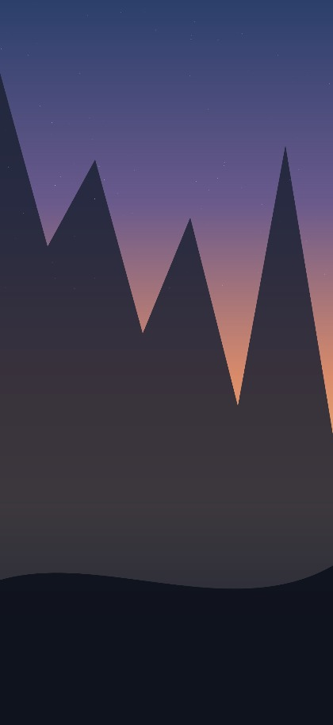
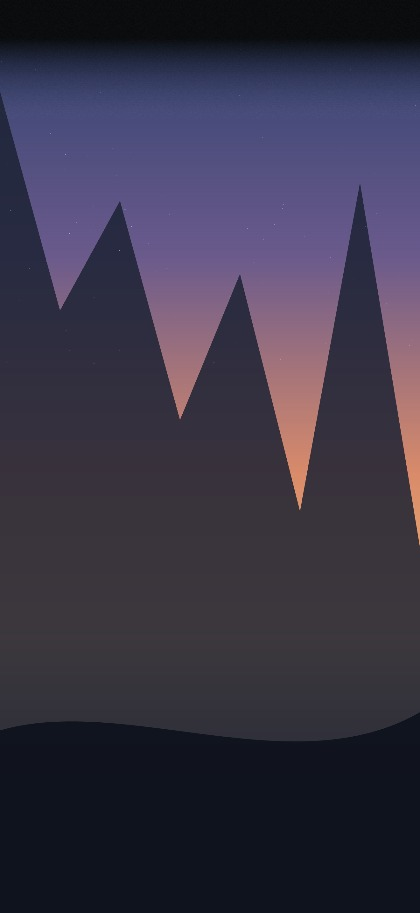

<div align="center">

# 灵动岛渐变工具

**Dynamic Island Gradient**

给壁纸顶部加一层渐变蒙版，让 iPhone 的灵动岛和状态栏自然融进画面。

[](LICENSE)
[]()
[]()
[]()
[]()

简体中文 · [English](README.en.md)




</div>

---

## 问题是这样的

iPhone 14 Pro 之后，屏幕顶部多了「灵动岛」—— 一块永久的黑色药丸。

如果你用一张明亮的照片当锁屏，顶部那块黑色硬件就会**硬生生切**在画面里。苹果自己的壁纸会做顶部压暗处理，你自己下的图不管。

**灵动岛渐变工具只做一件事**：在壁纸顶部盖一层从实到透的渐变。

```
┌──────────────┐         ┌──────────────┐
│  天空          │         │▒▒▒▒▒▒▒▒▒▒▒▒▒▒│  ← 纯色区，盖住灵动岛
│              │         │▒▒▒▒▒▒▒▒▒▒▒▒▒▒│
│              │   ──►   │▓▓▓▓▓▓▓▓▓▓▓▓▓▓│  ← 过渡区
│   山  ⛰️       │         │   山  ⛰️      │  ← 原图一个像素都不动
└──────────────┘         └──────────────┘
```

界面直接拖动分割线就能对比前后：


---

## 怎么用

**不用装、不用配、不用联网。**

1. 下载这个仓库（或只下载 `index.html`）
2. **双击 `index.html`** —— 浏览器会打开工具
3. 把壁纸拖进去，拖分割线调效果
4. 点「下载壁纸」，传到 iPhone 设为锁屏

> 想用在线版？把仓库开启 GitHub Pages 即可，手机上也能直接开。

---

## 功能

| 功能 | 说明 |
|---|---|
| **三种渐变颜色** | 纯黑 / 同色采样（自动取壁纸顶部均色）/ 自定义颜色 |
| **覆盖强度** | 0~100%，可以只「压暗」不完全盖住 |
| **两段式高度控制** | 纯色区高度 + 渐变结束高度，都用百分比（自动换算成当前图的像素值） |
| **四种过渡曲线** | 缓出 / 线性 / 缓入 / S 型，配实时曲线缩略图 |
| **拖动对比** | 分割线随鼠标 / 手指 / 方向键移动，左右对照原图与处理后 |
| **锁屏实机预览** | 宽屏时旁边模拟一台 iPhone 锁屏，时间是真实时间 |
| **灵动岛参考框** | 虚线标出灵动岛与状态栏安全区的参考位置 |
| **抗色带噪点** | 极细噪点打散深色渐变在 OLED 上的色带 |
| **参数记忆** | 上次调的值下次还在（存浏览器本地） |
| **不缩图导出** | JPEG / PNG，按原分辨率输出，文件名带参数 |
| **深浅色主题** | 跟随系统，也可手动切换 |

### 支持的输入方式

拖拽 · 点选 · `⌘V` 粘贴剪贴板 · 自带示例图

---

## 隐私

这类工具最该讲清楚的就是这个。

- **无网络请求**。代码里没有一行 `fetch` / `XMLHttpRequest` / `WebSocket`，也没有任何外部资源（字体、图标库、统计脚本统统没有）。
- **图片不上传、不落盘**。全程在浏览器内存里处理，关掉标签页就没了。图片内容不会被写入任何存储。
- **只记参数**。你的滑杆设置存在浏览器 `localStorage`，随时可在浏览器设置里清掉。
- **可审计**。整个工具就是一个 `index.html`，用文本编辑器打开就能从头读到尾。

**你可以断网使用，效果完全一样。**

---

## 技术说明

<details>
<summary>为什么它拖动滑杆不卡（点开看）</summary>

多数同类工具的做法是 `getImageData` → 逐像素 `for` 循环 → `putImageData`。
一张 iPhone 壁纸是 1320×2868 ≈ **380 万个像素**，每次滑杆移动都要跑一遍这个循环，必然掉帧。

这里换了个路子：

1. 把过渡曲线**离散成 64 个色标**，交给 `createLinearGradient()` —— 合成由浏览器（GPU）完成；
2. 只对画布做**两次 `drawImage` + 一次 `fillRect`**，无论图片多大，开销都接近常数；
3. 「同色采样」用 `drawImage` 把目标区域缩放到 **1×1 像素** 再读回 —— 缩放本身就是一次 box 平均，比 JS 循环求和快几十倍；
4. 拖动时用 `requestAnimationFrame` 合并重绘，一帧最多画一次。

结果：1320×2868 的原图上拖滑杆是实时的。

</details>

<details>
<summary>正确性验证</summary>

无头 Chrome 自检覆盖以下断言：

- 顶部纯色区像素值 == 设定基色
- 「渐变结束高度」以下的像素与原图**逐字节一致**
- 导出 blob 类型 / 体积正常
- 桌面 1440px 与手机 390px 视口均无横向溢出、无 JS 报错

</details>

---

## 文件结构

```
DynamicIslandGradient/
├── index.html            ← 主程序（单文件，双击即用）
├── 使用说明.html          ← 图文说明书（浏览器打开）
├── help.html             ← 说明书英文名副本，手机上好输网址
├── 启动.command           ← 双击起本地服务器（想用手机访问时用）
├── README.md / README.en.md
├── CHANGELOG.md
├── LICENSE               ← MIT
├── docs/
│   ├── 使用说明.md         ← 说明书内容源（唯一）
│   ├── build_help.py     ← md → html 生成脚本（零依赖）
│   ├── 生成说明书.command   ← 双击重新生成说明书
│   └── 版本说明.md
└── screenshots/
```

---

## 常见问题

**Q：导出的图会不会被压缩、变小？**
不会。导出就是原图分辨率，一个像素都不缩。JPEG 画质默认 95%，可以在面板里调。

**Q：HEIC 打不开？**
Chrome / Firefox 解不了 HEIC，用 Safari，或者先转成 JPG。工具会明确提示，不会静默失败。

**Q：手机上能用吗？**
能。双击 `启动.command`，手机连同一 WiFi，浏览器访问终端显示的地址。布局已做移动端适配。

**Q：为什么「同色采样」的颜色有时候不太对？**
采样取的是图片最顶部中间三分之一的平均色。如果壁纸顶部正好有个深色物体，采样会被带偏 —— 这时改用「纯黑」或「自定义颜色」更稳。

---

## 开发与自检

改 `index.html` 里的 CSS 变量即可换配色，改 `const DEFAULTS` / `const PRESETS` 换默认参数，浏览器刷新就生效，没有构建步骤。

说明书改 `docs/使用说明.md`，然后双击 `docs/生成说明书.command` 重新生成 HTML —— **只维护 md 一份**，避免两个版本内容打架。

---

## License

MIT © [js-ping](https://github.com/js-ping)
